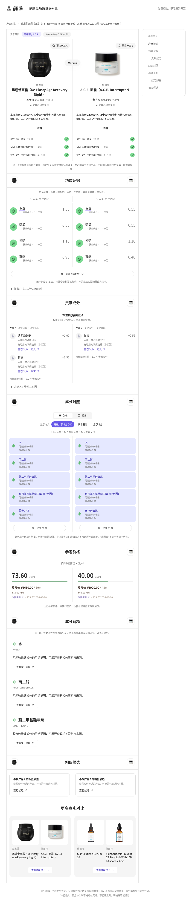

# 成分真言 · Ingredient Evidence Explorer

[中文](README.zh-CN.md)

A cosmetics ingredient and claims-evidence prototype developed for the 2026 L'Oréal beauty-tech hackathon. It connects product ingredients, evidence records, concentration estimates and an interactive comparison interface. The repository contains the React frontend, FastAPI backend, seed-data loaders and deployment setup.



*An existing project screenshot. Data coverage and evidence strength vary by product and ingredient.*

## What it does

- Explore products and their ingredient records.
- Compare ingredient composition and evidence-linked claims.
- Show concentration estimates with uncertainty when an ordered ingredient list is available.
- Support a grounded multi-agent discussion interface, depending on configured model services.

The application is a prototype, not clinical advice. Regulatory classifications and safety assessments are distinguished from efficacy evidence. Unverified information remains unknown; the interface must not turn an estimate into an established concentration or outcome.

## Local development

Python 3.11 is required. From the repository root:

```bash
python3.11 -m venv .venv
.venv/bin/python -m pip install -r requirements.txt
npm --prefix frontend ci
npm --prefix frontend run build
PYTHONPATH=backend .venv/bin/python -m uvicorn app.main:app --host 127.0.0.1 --port 8008
```

Data loading, database settings and optional model services require project-specific configuration. See [the project baseline](成分真言-最终总纲-v4.md), `backend/app/config.py`, and `deploy/`; a clean clone does not include every external model or dataset. The seed data and showcase deployment are separate from a full research setup.

## Container showcase

The existing `Dockerfile` builds the frontend and starts `deploy.bootstrap` on port 7860. Check the settings and optional credentials in `deploy/` before running it. Model weights, raw data and credentials stay outside Git.

## Verification

```bash
.venv/bin/python -m pytest
npm --prefix frontend run build
```

This README documents the existing implementation; it does not assert that all historical roadmap items are complete or that an old test count describes the current checkout. No repository-wide licence is added here; third-party content keeps its original terms.
