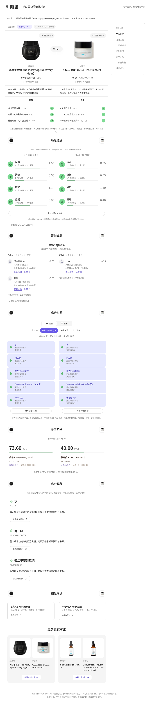

# 成分真言 · 化妆品成分与证据核验

[English](README.md)

这是欧莱雅 2026 美妆科技黑客松的参赛原型，尝试把产品成分、功效证据和浓度估计放在一起，让用户能够查看来源、比较产品，并看清哪些结论仍不确定。仓库包含 React 前端、FastAPI 后端、种子数据加载器和部署配置。



## 能做什么

- 查看产品与成分资料，比较成分组成。
- 追溯功效宣称所关联的证据。
- 对有官方降序成分表的产品显示带不确定性的浓度估计。
- 在配置好相应模型服务后，使用有证据约束的多角色讨论界面。

这是原型，不提供临床建议。安全评估、监管分类与功效证据分别展示；估计不写成确定浓度，未核实的信息保留未知。旧路线中的目标不等于已经完成的功能。

## 本地运行

需要 Python 3.11 与 Node.js。从仓库根目录执行：

```bash
python3.11 -m venv .venv
.venv/bin/python -m pip install -r requirements.txt
npm --prefix frontend ci
npm --prefix frontend run build
PYTHONPATH=backend .venv/bin/python -m uvicorn app.main:app --host 127.0.0.1 --port 8008
```

数据加载、数据库与可选模型服务需要另行配置，见[最终总纲](成分真言-最终总纲-v4.md)、`backend/app/config.py` 和 `deploy/`。干净克隆不包含全部外部数据与模型。种子数据展示与完整研究环境分别配置。

现有 Dockerfile 会构建前端，并通过 `deploy.bootstrap` 在 7860 端口启动展示环境；运行前核对部署配置与可选凭据。

## 验证

```bash
.venv/bin/python -m pytest
npm --prefix frontend run build
```

本说明不把历史测试数量当作当前结果。不新增仓库整体许可，第三方资料保留原有条款；权重、原始数据与凭据不进 Git。
